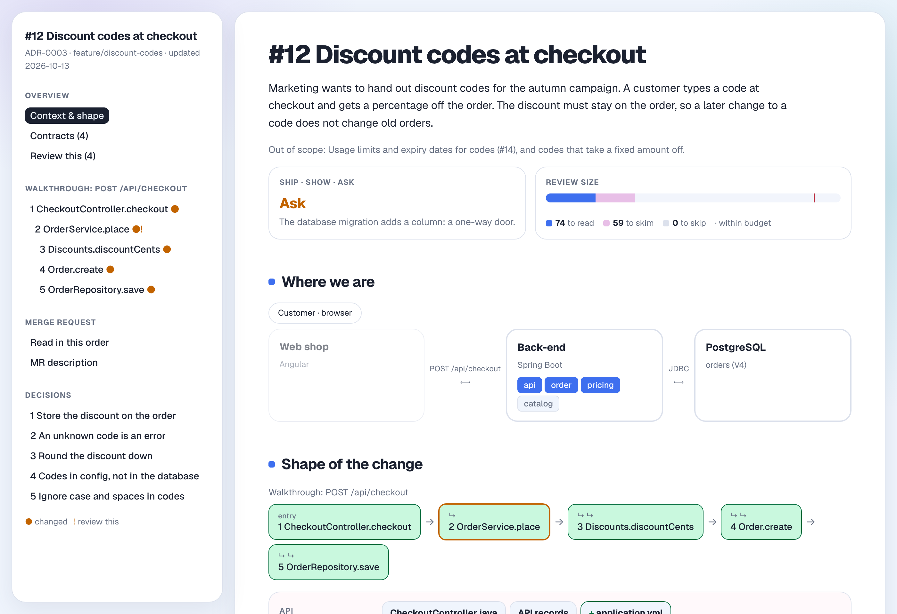

# stijnhooft-skills

Skills for [Claude Code](https://claude.com/claude-code). A skill teaches the agent a new task.

## Skills

| Skill | What it does |
|---|---|
| [**session-guide**](skills/session-guide/README.md) | Explains the code the agent changed. You get one web page with the reasons for each choice, the other options, a tour through the code, and the proof that it works. It can also write the text for your merge request. |

<picture>
  <source media="(prefers-color-scheme: dark)" srcset="docs/screenshots/session-guide-overview-dark.png">
  
</picture>

## How to use

Each skill has its own README with all the details. For **session-guide**, run it at the end of a
session, before you close the conversation:

| Command | What it does |
|---|---|
| `/session-guide session` | A guide to what changed in this session |
| `/session-guide ticket` | A guide to the whole branch, over all sessions |
| `/session-guide mr` | The text for your merge request |
| `/session-guide reviewed` | Remembers which version the reviewers have seen |
| `/session-guide quiz` | A few questions, to check that you understand the change |

## How to install

You need the [`skills`](https://github.com/vercel-labs/skills) tool. This command installs the
skill for all your projects:

```bash
npx skills add stainii/stijnhooft-skills --skill session-guide -g
```

Without `-g`, it installs the skill only for the project you are in.

To get the newest version:

```bash
npx skills update
```

## How to contribute

Get the code, and link the skill into Claude Code. Then Claude Code uses your changes right away.

```bash
git clone https://github.com/stainii/stijnhooft-skills.git ~/projecten/stijnhooft-skills
```

```bash
ln -s ~/projecten/stijnhooft-skills/skills/session-guide ~/.claude/skills/session-guide
```

Each skill has its own folder, `skills/<name>/`, with two files:

- `SKILL.md`: the instructions for the agent.
- `README.md`: the explanation for people.

Tests go in `tests/<name>/`. They are not in the skill folder, so they are not installed. Run them
from the main folder of the repo:

```bash
python3 -m unittest discover -s tests/session-guide
```

To add a skill, make a new folder in `skills/` and add a row to the table above.
