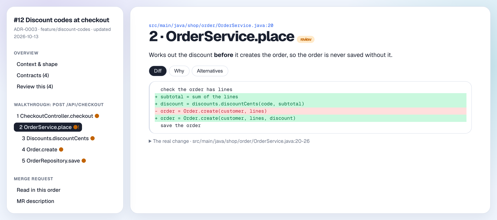
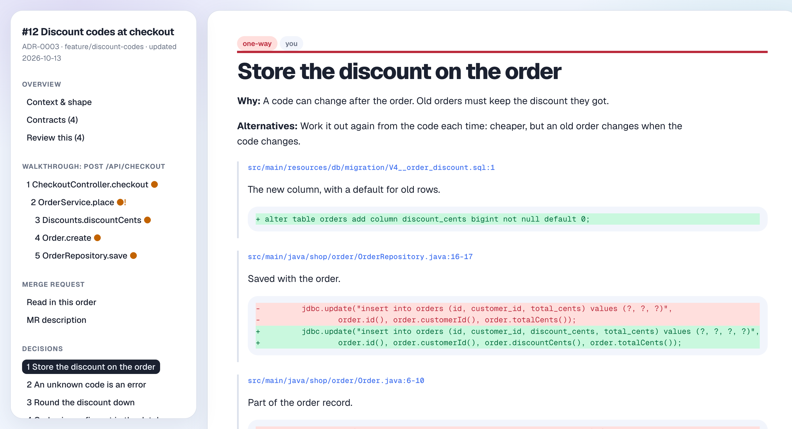
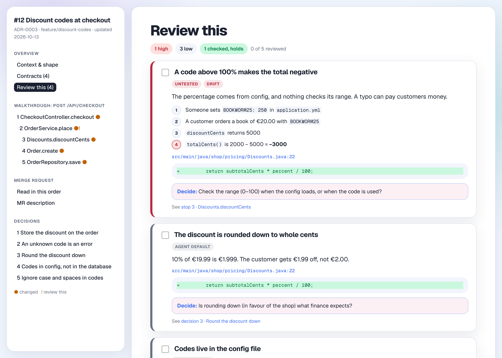
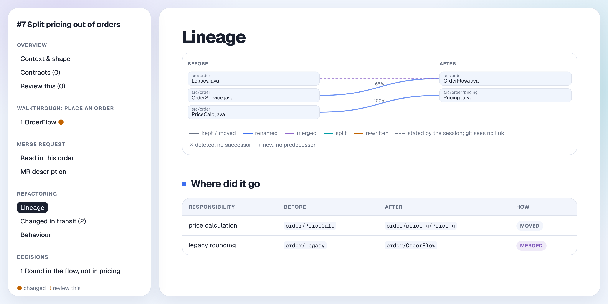

# session-guide

A skill for [Claude Code](https://claude.com/claude-code). It explains the code that the agent
changed, so you can check it and take ownership of it.

The diff shows *what* changed. It does not show *why*, which other options there were, or what the
agent tried and gave up on. Only the conversation knows that. This skill writes it down before the
conversation ends.

<picture>
  <source media="(prefers-color-scheme: dark)" srcset="../../docs/screenshots/session-guide-overview-dark.png">
  
</picture>

## What you get

You get one web page for each session or ticket. It has two main parts:

- **Walkthrough**: follows one real request through the changed code, step by step. Each step
  shows the file and line, explains why the code looks this way, and shows the change.
- **Decisions**: one page for each decision, also the small ones. Each page shows:
  - the reason;
  - the other options, and why they were not chosen;
  - who decided: you, or the agent on its own;
  - whether the decision is easy or hard to undo;
  - all the code that belongs to it.

<picture>
  <source media="(prefers-color-scheme: dark)" srcset="../../docs/screenshots/session-guide-walkthrough-dark.png">
  
</picture>

<picture>
  <source media="(prefers-color-scheme: dark)" srcset="../../docs/screenshots/session-guide-decision-dark.png">
  
</picture>

The first page is a summary with pictures:

| Part | What it shows |
|---|---|
| **Where we are** | The parts of the system, with the changed parts marked |
| **Walkthrough chain** | The path of the request, with the changed steps marked |
| **Change map** | Every changed file, with the number of added and removed lines |
| **Decisions** | All decisions in a grid. Look hardest at the ones that are hard to undo *and* that the agent took on its own |
| **Evidence** | Before and after, as a picture, and the test that proves it |
| **Merge danger** | How hard the change is to undo, and how much of the system it affects |

There is more:

- **Contracts**: every changed method signature, type, endpoint and database schema. For big ones,
  a table shows before and after side by side.
- **Review this**: a list of things to check, the most important first. Each card says what the
  risk is, shows the proof, and asks for your decision. Things that were checked and are fine show
  as green cards. You can tick a card when you are done with it.

<picture>
  <source media="(prefers-color-scheme: dark)" srcset="../../docs/screenshots/session-guide-review-dark.png">
  
</picture>

### When you refactor

When files were deleted, added, renamed, split or merged, you get three more parts:

- **Lineage**: old files on the left, new files on the right, with lines between them that show
  what happened. A deleted file with no new place stands out.
- **Changed in transit**: code that moved, before and after. Lines that now do something different
  are marked.
- **Behaviour**: a refactoring should not change what the code does. This part lists what stayed
  the same, what changed on purpose, and what was removed. It also shows which new test replaces
  which old test.

<picture>
  <source media="(prefers-color-scheme: dark)" srcset="../../docs/screenshots/session-guide-lineage-dark.png">
  
</picture>

Git cannot always see that two files were merged, or that a file was rewritten under a new name.
So run `/session-guide ticket` at the end of **every** session, not only at the end of the ticket.

### For the merge request

- **Review size**: sorts every changed line into *read*, *skim* or *skip*. The goal is at most 400
  lines to read.
- **Read in this order**: where the reviewer should start, and what they can skip.
- **Split plan**: when the change is too big, a plan to split it into smaller merge requests.
- **Description**: a short text for GitLab or GitHub, with a diagram and a checklist for the
  reviewer.
- **Since last review**: after a review, shows what changed since the version the reviewers saw,
  and where each comment was answered.

## How to use

Run the skill yourself at the end of a session, before you close the conversation:

| Command | What it does |
|---|---|
| `/session-guide session` | A guide to what changed in this session |
| `/session-guide ticket` | A guide to the whole branch, over all sessions |
| `/session-guide mr` | The text for your merge request |
| `/session-guide reviewed` | Remembers which version the reviewers have seen. This is a local file; it is never pushed |
| `/session-guide quiz` | 3 to 5 questions, one at a time, to check that you understand the change |

The skill writes the guides to `.claude/session-guides/` in your repo. For each guide you get:

- `<name>.html`: the page;
- `<name>.mr.md`: the merge request text;
- a folder `<name>/` with the data behind the page.

The skill checks that git ignores this folder. It asks you before it writes anywhere else.

Open the page in a browser. Links inside the page work best with a small web server:

```bash
python3 -m http.server 4310 --directory .claude/session-guides
```

The skill does not run on its own, on purpose. After the session ends, the conversation is gone,
so an automatic run would come too late.

### Why you can trust the guide

- **A script checks the guide against the code** before it makes the page. For example: a changed
  file that the guide does not explain, or a line number that does not exist. If there is a
  problem, there is no page.
- **The code on the page comes from git.** The agent does not type it again, so it is always the
  real code.
- **The agent checks each step of the walkthrough** in the code. If it cannot confirm a step, the
  step is marked *unverified*.
- **Guesses are marked** as *assumed*.
- **Decisions that the agent took on its own are marked** *agent default*, and they go on the
  review list.
- **It uses what your repo already has.** It links to your ADRs and `CONTEXT.md` instead of
  repeating them. For a big architecture decision, it suggests a new ADR.

### Why it is cheap

The agent does not write the page. It writes only data: the *why*. Scripts do the rest: they count
lines, find renames, draw the change map and copy the code from git. The agent only reads the code
that a reviewer must read.

A big change is more than 50 files or more than 3000 changed lines. The skill splits it into
smaller jobs, and a separate agent does each job. The main agent reads only their results, not all
the code.

## How to install

You need the [`skills`](https://github.com/vercel-labs/skills) tool, `git`, and `python3`. This
command installs the skill for all your projects:

```bash
npx skills add stainii/stijnhooft-skills --skill session-guide -g
```

Without `-g`, it installs the skill only in this project, in `.claude/skills/`. You can commit that
folder, so your team gets the skill too.

Useful options:

- `-a claude-code`: install only for Claude Code.
- `--copy`: copy the files instead of linking them.

To get the newest version:

```bash
npx skills update session-guide
```

## How to contribute

Get the code, and link the skill into Claude Code. Then Claude Code uses your changes right away.

```bash
git clone https://github.com/stainii/stijnhooft-skills.git ~/projecten/stijnhooft-skills
```

```bash
ln -s ~/projecten/stijnhooft-skills/skills/session-guide ~/.claude/skills/session-guide
```

### Files

| File | What it is |
|---|---|
| `SKILL.md` | The steps the agent follows, and the words it uses |
| `guide.schema.ts` | The format of `guide.json`, the only file the agent writes |
| `scripts/gather.py` | Measures the change and writes `facts.json`: files, lines, renames, jobs |
| `scripts/build.py` | Checks the guide against the code, then makes the page and the merge request text |
| `scripts/guide.py`, `source.py`, `views.py` | The parts of `build.py` |
| `scripts/files.py` | Lists the changed files, for each job |
| `template.html` | The design of the page, in light and dark mode. Do not change it for one guide |
| `SUBAGENTS.md` | Only for big changes: how to split the work over several agents |
| `REFACTORING.md` | Only for a refactoring |
| `MERGE-REQUEST.md` | Only for `mr` and `reviewed` |
| `QUIZ.md` | Only for `quiz` |

The page is one HTML file. It loads fonts and diagrams from the internet. Without internet, it
still works, but without the diagrams.

### Tests

The tests are in [`tests/session-guide`](../../tests/session-guide). They are not in the skill
folder, so they are not installed. Run them from the main folder of the repo:

```bash
python3 -m unittest discover -s tests/session-guide
```

## Thanks to

- The pictures (call trees, file trees, pseudocode) come from HumanLayer's
  [show-me](https://www.humanlayer.com/blog/show-me-skill) skill and Matt Pocock's `/pr` skill.
  *Evidence* and *Merge danger* come from Matt Pocock's skill.
- Keeping refactoring apart from other changes: Chromium's
  [CL tips](https://chromium.googlesource.com/chromium/src.git/+show/HEAD/docs/cl_tips.md).
- The limit of 200 to 400 lines per review: a
  [study by SmartBear and Cisco](https://agileconnection.com/article/largest-case-study-code-reviews-ever).
  It is data from one company, so see it as a guideline.
- [Ship / Show / Ask](https://martinfowler.com/tags/version%20control.html), by Rouan Wilsenach.
- [`git range-diff`](https://www.git-scm.com/docs/git-range-diff), to review again after a rebase.
